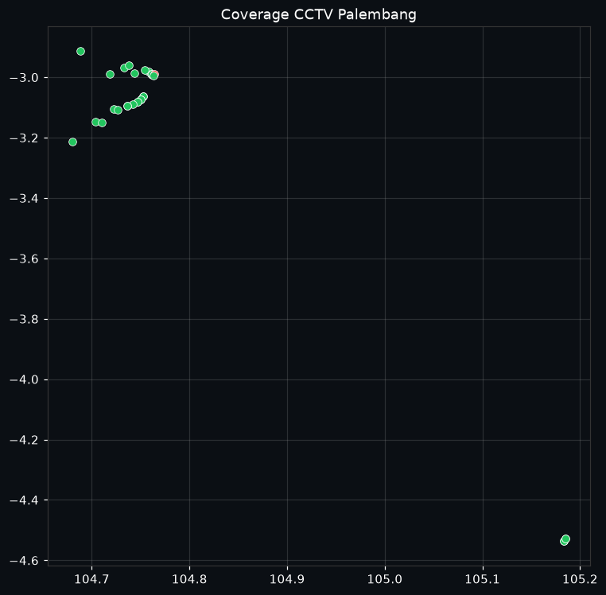
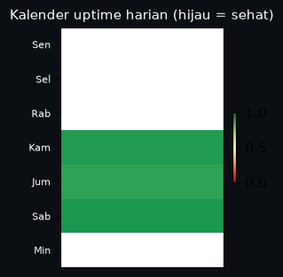

```
   ___  ___  ___  ___  ___  ___
  / _ \/ _ \/ _ \/ _ \/ _ \/ _ \   PALEMBANG CCTV STREAMS
 / ___/ ___/ ___/ ___/ ___/ ___/   (unofficial, auto-update)
/_/  /_/  /_/  /_/  /_/  /_/
```

<!-- LINKS:START -->
[](https://github.com/akuncadangans1tu-beep/Palembang-CCTV-Streams/actions/workflows/update-streams.yml)
[](https://github.com/akuncadangans1tu-beep/Palembang-CCTV-Streams/blob/main/status.json)
[](https://github.com/akuncadangans1tu-beep/Palembang-CCTV-Streams/blob/main/status.json)

```text
https://raw.githubusercontent.com/akuncadangans1tu-beep/Palembang-CCTV-Streams/main/streams.m3u8
```

Mirror CDN (lebih cepat): `https://cdn.jsdelivr.net/gh/akuncadangans1tu-beep/Palembang-CCTV-Streams@main/streams.m3u8`


<!-- LINKS:END -->

Playlist CCTV publik **Kota Palembang & koridor tol Sumatera** (HLS stabil), dirawat otomatis 3× sehari. Ala IPTV-Org.

**EN:** Auto-updated public CCTV playlist for Palembang & South Sumatra toll roads (stable HLS). Unofficial community project.

## 📊 Status Kamera
<!-- STATUS:START -->
> 🕒 **27 Nov 2026 20:49 WIB** · **30** kamera · 🟢 29 · 🔴 1

| Kamera | Grup | Status | Uptime | Riwayat | Kualitas |
|---|---|:--:|:--:|---|:--:|
| CCTV Benteng Kuto Besak | Alang-Alang Lebar | 🟢 | 100% | ▰▰▰▰▰▰▰▰▰▰▰▰▰▰ | 704x576 |
| CCTV Lampu Merah Kol Atmo | Alang-Alang Lebar | 🟢 | 71% | ▱▰▰▱▱▰▰▰▱▰▰▰▰▰ | 704x576 |
| CCTV Simpang Angkatan 45 | Alang-Alang Lebar | 🟢 | 93% | ▰▰▰▰▰▰▰▰▰▰▰▰▱▰ | 704x576 |
| CCTV Simpang Macan Lindungan | Alang-Alang Lebar | 🟢 | 79% | ▰▰▱▰▱▰▰▱▰▰▰▰▰▰ | 704x576 |
| CCTV Simpang Polda | Alang-Alang Lebar | 🟢 | 79% | ▰▰▰▰▱▰▱▰▱▰▰▰▰▰ | 704x576 |
| CCTV Masjid Agung | Bukitkecil | 🟢 | 71% | ▰▰▰▰▱▰▱▰▰▰▰▱▱▰ | 1920x1080 |
| CCTV SP Samsat | Bukitkecil | 🟢 | 86% | ▰▰▰▰▰▰▱▰▰▰▰▰▱▰ | 1920x1080 |
| CCTV KM 12 | Ilir Timur Dua | 🟢 | 64% | ▱▰▱▰▱▱▰▰▱▰▰▰▰▰ | 704x576 |
| CCTV Lapangan Parkir Pasar 16 | Ilir Timur Tiga | 🟢 | 93% | ▰▰▰▰▰▰▰▰▰▰▰▰▱▰ | 704x576 |
| CCTV SP Charitas | Ilir Timur Tiga | 🟢 | 93% | ▰▰▰▱▰▰▰▰▰▰▰▰▰▰ | 1920x1080 |
| CCTV Pasar 16 | Jakabaring | 🔴 | 79% | ▰▱▰▰▰▱▰▰▰▰▰▰▰▱ | 704x576 |
| CCTV Plaza 7 Ulu | Jakabaring | 🟢 | 93% | ▰▰▰▰▰▰▰▰▱▰▰▰▰▰ | 704x576 |
| Lampung 180+000 A | Tol Lampung | 🟢 | 100% | ▰▰▰▰▰▰▰▰▰▰▰▰▰▰ | — |
| Lampung 180+000 B | Tol Lampung | 🟢 | 100% | ▰▰▰▰▰▰▰▰▰▰▰▰▰▰ | — |
| Lampung 181+000 A | Tol Lampung | 🟢 | 100% | ▰▰▰▰▰▰▰▰▰▰▰▰▰▰ | — |
| Lampung 181+000 B | Tol Lampung | 🟢 | 100% | ▰▰▰▰▰▰▰▰▰▰▰▰▰▰ | — |
| Palindra 01+600 A | Tol Palindra | 🟢 | 100% | ▰▰▰▰▰▰▰▰▰▰▰▰▰▰ | — |
| Palindra 01+600 B | Tol Palindra | 🟢 | 100% | ▰▰▰▰▰▰▰▰▰▰▰▰▰▰ | — |
| Palindra 02+600 A | Tol Palindra | 🟢 | 100% | ▰▰▰▰▰▰▰▰▰▰▰▰▰▰ | — |
| Palindra 02+600 B | Tol Palindra | 🟢 | 100% | ▰▰▰▰▰▰▰▰▰▰▰▰▰▰ | — |
| Palindra 03+600 A | Tol Palindra | 🟢 | 93% | ▰▰▰▰▰▱▰▰▰▰▰▰▰▰ | — |
| Palindra 03+600 B | Tol Palindra | 🟢 | 100% | ▰▰▰▰▰▰▰▰▰▰▰▰▰▰ | — |
| Palindra 04+600 B | Tol Palindra | 🟢 | 93% | ▰▰▰▰▰▰▰▰▱▰▰▰▰▰ | — |
| Palindra 05+600 A | Tol Palindra | 🟢 | 100% | ▰▰▰▰▰▰▰▰▰▰▰▰▰▰ | — |
| Palindra 05+600 B | Tol Palindra | 🟢 | 100% | ▰▰▰▰▰▰▰▰▰▰▰▰▰▰ | — |
| PALINDRA Gate Pemulutan | Tol Palindra | 🟢 | 100% | ▰▰▰▰▰▰▰▰▰▰▰▰▰▰ | — |
| PALINDRA GT Indralaya | Tol Palindra | 🟢 | 93% | ▰▰▰▰▰▰▰▱▰▰▰▰▰▰ | — |
| PALINDRA GT KTM RAMBUTAN | Tol Palindra | 🟢 | 93% | ▰▰▰▰▰▰▰▱▰▰▰▰▰▰ | — |
| PALINDRA IC KTM | Tol Palindra | 🟢 | 93% | ▰▰▰▰▰▰▰▱▰▰▰▰▰▰ | — |
| PALINDRA IC Pemulutan | Tol Palindra | 🟢 | 93% | ▰▰▰▰▰▰▰▱▰▰▰▰▰▰ | — |
<!-- STATUS:END -->

## 🖼️ Visual





## 📦 Data & laporan
[UPTIME.md](UPTIME.md) · [CHANGELOG.md](CHANGELOG.md) · [feed.xml](feed.xml) (RSS) · [data/uptime.csv](data/uptime.csv) · [status.json](status.json) · [playlist.json](playlist.json) · [REPORT.md](REPORT.md)

## 🚀 Fitur
Auto-check 3×/hari + grace 3 hari; thumbnail mingguan; dataset uptime per jam; leaderboard & sparkline; deteksi flapping; statistik kualitas; mirror jsDelivr; release bulanan + rotasi data; RSS; auto-issue kamera mati; mudik-mode.

## 🛠️ Cara pakai
Salin tautan playlist di blok atas ke VLC / app IPTV, atau pakai mirror CDN jsDelivr, atau scan QR.

## 🌟 Showcase / used by
<!-- Tambahkan proyek/app yang memakai playlist ini di sini -->
- (belum ada — kirim PR kalau kamu pakai!)

## ⚠️ Disclaimer
Independen, tidak berafiliasi dengan Pemkot Palembang / DisHub / Pemprov Sumsel. Semua tautan dari sumber publik.

## 🗺️ Area belum tercakup
<!-- GAPS:START -->
📍 **16 kecamatan** Palembang & **2 ruas tol** belum tercakup. [Lihat detail & cara bantu →](GAPS.md)
<!-- GAPS:END -->

## 👤 Maintainer

Proyek ini dikelola oleh **[@akuncadangans1tu-beep](https://github.com/akuncadangans1tu-beep)**.

Untuk usul kamera baru atau laporan masalah, buka [Issues](https://github.com/akuncadangans1tu-beep/Palembang-CCTV-Streams/issues).

## 🤝 Kontribusi
[CONTRIBUTING.md](CONTRIBUTING.md) · [FAQ](FAQ.md) · [Arsitektur](ARCHITECTURE.md) · [Keamanan](SECURITY.md) · [Kode Etik](CODE_OF_CONDUCT.md)
⚠️ Hanya kamera publik Palembang / koridor tol; kamera pribadi dilarang.
