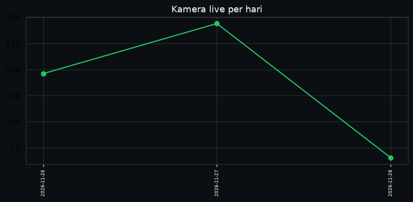
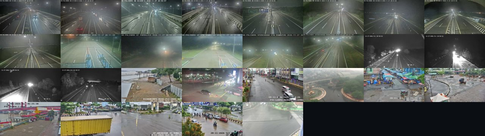
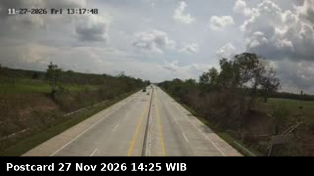

```
   ___  ___  ___  ___  ___  ___
  / _ \/ _ \/ _ \/ _ \/ _ \/ _ \   PALEMBANG CCTV STREAMS
 / ___/ ___/ ___/ ___/ ___/ ___/   (unofficial, auto-update)
/_/  /_/  /_/  /_/  /_/  /_/
```

<!-- LINKS:START -->
_Badge, tautan, mirror CDN, QR dibuat otomatis._
<!-- LINKS:END -->

Playlist CCTV publik **Kota Palembang & koridor tol Sumatera** (HLS stabil), dirawat otomatis 3× sehari. Ala IPTV-Org.

**EN:** Auto-updated public CCTV playlist for Palembang & South Sumatra toll roads (stable HLS). Unofficial community project.

## 📊 Status Kamera
<!-- STATUS:START -->
_Otomatis._
<!-- STATUS:END -->

## 🖼️ Visual





## 📦 Data & laporan
[UPTIME.md](UPTIME.md) · [CHANGELOG.md](CHANGELOG.md) · [feed.xml](feed.xml) (RSS) · [data/uptime.csv](data/uptime.csv) · [status.json](status.json) · [playlist.json](playlist.json) · [REPORT.md](REPORT.md)

## 🚀 Fitur
Auto-check 3×/hari + grace 3 hari; thumbnail mingguan; dataset uptime per jam; leaderboard & sparkline; deteksi flapping; statistik kualitas; mirror jsDelivr; release bulanan + rotasi data; RSS; auto-issue kamera mati; mudik-mode.

## 🛠️ Cara pakai
Salin tautan playlist di blok atas ke VLC / app IPTV, atau pakai mirror CDN jsDelivr, atau scan QR.

## 🌟 Showcase / used by
<!-- Tambahkan proyek/app yang memakai playlist ini di sini -->
- (belum ada — kirim PR kalau kamu pakai!)

## ⚠️ Disclaimer
Independen, tidak berafiliasi dengan Pemkot Palembang / DisHub / Pemprov Sumsel. Semua tautan dari sumber publik.

## 🤝 Kontribusi
[CONTRIBUTING.md](CONTRIBUTING.md) · [FAQ](FAQ.md) · [Arsitektur](ARCHITECTURE.md) · [Keamanan](SECURITY.md) · [Kode Etik](CODE_OF_CONDUCT.md)
⚠️ Hanya kamera publik Palembang / koridor tol; kamera pribadi dilarang.
